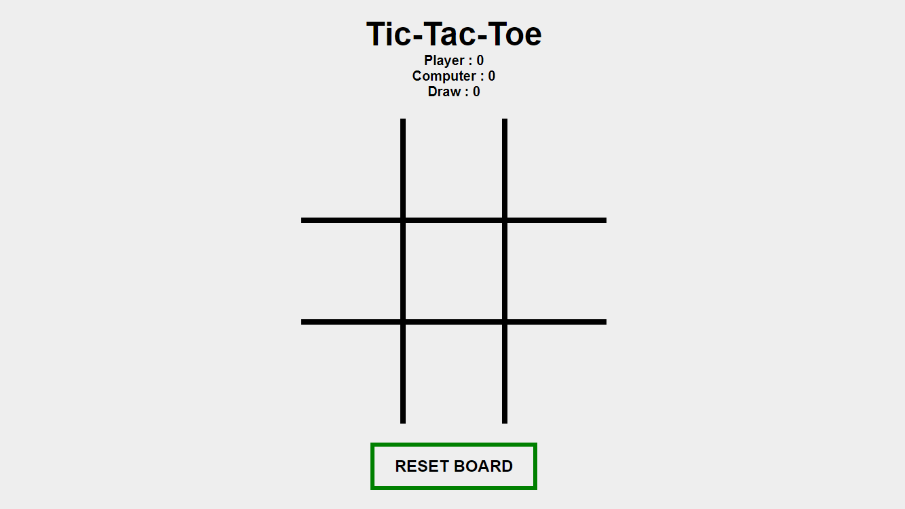

# TIC TAC TOE

**Created by:** Calon Arang / Ranbyus Varadha  
**Copyright © 2026 Calon Arang / Ranbyus Varadha**

A simple and lightweight Tic Tac Toe web game built with HTML, CSS, and JavaScript.

## Table of Contents

- [About the Project](#about-the-project)
- [Tech Stack](#tech-stack)
- [Getting Started](#getting-started)
- [Prerequisites](#prerequisites)
- [Installation](#installation)
- [How to Play](#how-to-play)
- [Reporting Issues](#reporting-issues)
- [Contributing](#contributing)
- [License](#license)

## About the Project

Tic Tac Toe is a simple browser-based game built using HTML, CSS, and JavaScript. It provides a lightweight gaming experience without requiring any additional software installation.

The game can be played in a modern web browser that supports HTML5, CSS3, and JavaScript.

### Screenshot

Add a screenshot of the game to the repository and name it `tictactoe.png`.

```markdown

```

## Tech Stack

- **HTML5** — Structures the game interface.
- **CSS3** — Styles the game interface.
- **JavaScript** — Implements the game logic.

## Getting Started

Follow the instructions below to run the game locally.

### Prerequisites

You only need a modern web browser that supports HTML5, CSS3, and JavaScript.

### Installation

1. Clone the repository:

   ```bash
   git clone https://github.com/rangdajavas407-cmd/tic-tac-toe-base-on-html.git
   ```

2. Navigate to the project directory:

   ```bash
   cd tic-tac-toe-base-on-html
   ```

3. Open the game's HTML file in your web browser.

   If the main file is named `index.html`, open that file directly.

## How to Play

1. Open the game in your web browser.
2. Take turns selecting available squares.
3. Follow the game's displayed rules to determine the winner.

*Note: Adjust these instructions if the game's actual mechanics differ.*

## Reporting Issues

If you encounter a bug or have a feature request, please open an issue in the repository:

[Report an Issue](https://github.com/rangdajavas407-cmd/RPG-Little-adventure/issues)

Include a clear description of the problem and the steps needed to reproduce it.

## Contributing

Contributions and suggestions are welcome.

1. Fork the repository.
2. Create a new branch for your changes.
3. Make and test your changes.
4. Submit a pull request describing your improvements.

Please ensure that your changes are consistent with the project's existing code and license.

## License

This project includes software components distributed under the GNU Lesser General Public License, version 2.1 (LGPL-2.1), as stated in the original project documentation.

The complete license text is available in `COPYING.LESSER`.

Official license:  
https://www.gnu.org/licenses/old-licenses/lgpl-2.1.html

**Important:** Confirm the license of the original source code and any third-party components before distributing this project. The project's own licensing terms should be stated clearly and consistently.

---

**Copyright © 2026 Calon Arang / Ranbyus Varadha.**
